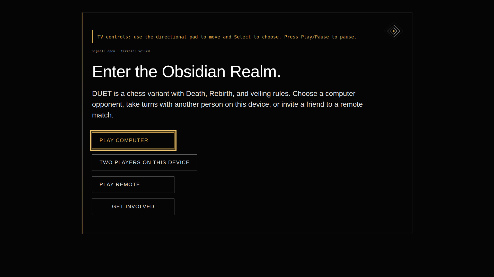
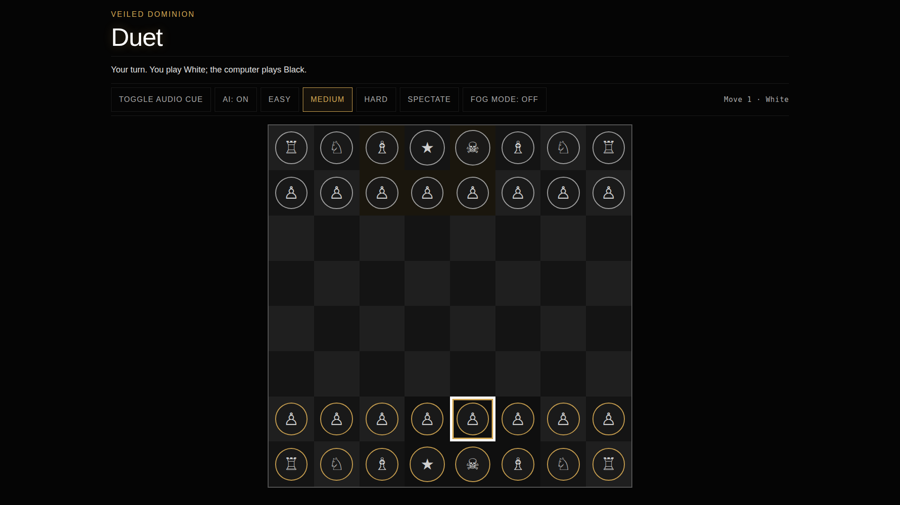

# DUET Fire TV prototype

This prototype adds a remote-first TV presentation to the existing browser game. It is opt-in so ordinary web/mobile visits are unchanged.

## What it adds

- TV-sized landing and gameplay layouts enabled by `?firetv=1` (or `?tv=1`).
- D-pad spatial focus for the landing and option controls.
- D-pad square navigation and Select-to-pick / Select-to-move interaction on the board.
- A high-contrast focus indicator and spoken-accessible labels on board squares.
- Play/Pause handling for pausing and resuming an in-progress match.
- Fire TV Back/Escape handling to return from the game to the home screen.

The first play path is **Play computer**. Two-player-on-one-screen remains available. The remote-match flow depends on the existing server/socket endpoint and should be validated against the deployed service before being advertised as a Fire TV feature.

## Run locally

From the repository root:

```sh
npm install
npm start
```

Open `http://localhost:8080/?firetv=1` in a desktop browser and use keyboard arrows, Enter/Space, Escape, and the browser's Play/Pause key where available. Desktop browser testing is a development check, not proof of Fire TV certification.

## Fire TV validation / hackathon demo

Amazon supports hosted and packaged HTML5 web apps. The hosted-app route can use the deployed DUET page with the TV flag, for example `https://duet.loptrlab.com/?firetv=1`, and is the shortest route to the existing game backend. Configure that URL in Amazon's Web App Tester / developer tooling, then verify on an actual Fire TV or the Fire TV/Vega simulator. Keep the current web page deployed with the Fire TV CSS/JS before testing the hosted URL.

Test at minimum:

1. D-pad focus is visible on all menu actions.
2. Select starts Play computer and moves focus to the initial board square.
3. D-pad traverses the board; Select picks a piece and then a destination.
4. The AI replies and focus remains on the board after the move.
5. Play/Pause opens the pause layer; Play/Pause or Select resumes.
6. Back returns to the title screen, and the ordinary non-TV page is unchanged.
7. Layout and text remain readable at a typical 1080p viewing distance.

## Browser previews

The screenshots below are Chromium previews at 1920×1080, not Fire TV device captures.





Amazon's submission still requires a device/simulator demonstration, store assets and an appropriate Fire OS or Vega deliverable. This repository change is the TV-ready HTML5 client prototype; it is not an Appstore submission or a claim of physical-device acceptance.
